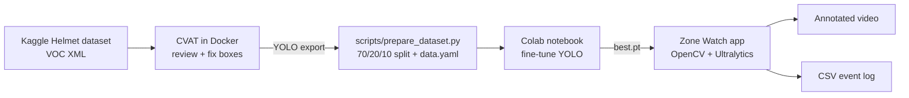
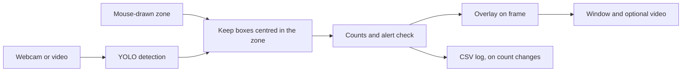

# Zone Watch 🦺

**Real-time helmet detection inside a user-drawn zone.** Draw a rectangle on a webcam or video feed; a custom-trained YOLO model detects heads *with* and *without* a helmet only inside that zone, counts them, and raises an alert when someone without a helmet enters.


*The demo runs the app on a slideshow of hand-picked test images, chosen to show the alert and the zone filter clearly. Those images are not a measure of accuracy: see [Results](#results) and [Limitations](#limitations).*

---

## Highlights

- End-to-end CV pipeline: **annotation (CVAT) → data prep → training (Colab GPU) → real-time app → Docker**
- Custom fine-tuned **YOLO** detector (Ultralytics), 2 classes
- Interactive **ROI** drawn with the mouse, centre-in-zone filtering, live counts and FPS
- Visual + logged **alerts** (CSV event log), optional annotated video export
- Optional **ByteTrack** object IDs with "entered/left zone" events
- Config-driven (no hard-coded paths/thresholds), type-hinted, documented code

## Architecture



Each frame in the app goes through the same steps:



## Pipeline

| Phase | What | Where |
|------:|------|-------|
| 1 | Annotation review in CVAT (local Docker) | [docs/cvat_setup.md](docs/cvat_setup.md) |
| 2 | Label validation, reproducible train/val/test split, `data.yaml` | `scripts/prepare_dataset.py` |
| 3 | Fine-tuning on Google Colab (free GPU) | `notebooks/train_colab.ipynb` |
| 4 | ROI detection app | `src/zone_watch/` |
| 5 | Dockerised inference | `Dockerfile`, [docs/docker.md](docs/docker.md) |

## Results

YOLO11n fine-tuned on 524 images, measured on the held-out test split (74 images, 152 boxes):

| Class | Precision | Recall | mAP@50 | mAP@50-95 |
|-------|----------:|-------:|-------:|----------:|
| All | 0.625 | 0.805 | 0.734 | 0.440 |
| With Helmet | 0.728 | 0.928 | 0.861 | 0.514 |
| Without Helmet | 0.521 | 0.681 | 0.607 | 0.365 |

The rarer *Without Helmet* class is the weak spot: about one in three such boxes is missed. The test split is small (48 *Without Helmet* boxes), so these numbers carry real uncertainty.

**Speed on CPU** (Ryzen 9 7845HX, including drawing and video saving): about 20 FPS on 1280x720 video, 15 FPS on the same video in Docker, and 5 FPS on portrait 4K video.

## Limitations

- **The model does not generalise to every viewpoint.** On a street video filmed mostly from the side and behind, with some motion blur, it found no heads at all in 722 frames, although the test scores looked reasonable. The test images come from the same dataset as the training images, so they could not reveal this.
- **Alerts are noisy.** About half of the *Without Helmet* boxes on the test split are wrong at the best F1 threshold, and an alert can flicker between frames. Raising `--confidence` trades false alarms for missed people.
- **Tracking IDs are not identities.** An object that is out of view for too long comes back with a new ID, and counts as a new entry. A track's class can also change between frames, so `left` rows report its most common class.
- **Webcam input is untested.** The app has been tested by hand on video files. Webcam input is implemented but has not been run with a real camera.

This is a portfolio project and is not suitable as a safety system.

## Project structure

```
zone-watch/
├── configs/      # YAML config for the app (model path, thresholds, ...)
├── data/         # datasets (git-ignored)
├── docs/         # setup guides, images, diagrams
├── models/       # trained weights, e.g. best.pt (git-ignored)
├── notebooks/    # Colab training notebook
├── scripts/      # data download / prep utilities
├── src/zone_watch/  # the application package
└── tests/        # tests for the zone, alert and logging logic
```

## Getting started

Trained weights are not in the repo: put your `best.pt` in `models/`.

```bash
python -m venv .venv
.venv\Scripts\activate          # Windows  (Linux/Mac: source .venv/bin/activate)
pip install -r requirements.txt
pip install -e .
```

Run on a webcam or a video file, then drag with the mouse to draw the zone (`r` resets it, `q` quits):

```bash
python -m zone_watch --source 0
python -m zone_watch --source path/to/video.mp4 --save-video outputs/annotated.mp4
```

Add `--track` to give each object an ID with ByteTrack and log when it enters or leaves the zone to `logs/zone_events.csv`:

```bash
python -m zone_watch --source path/to/video.mp4 --track
```

Run without a window by giving the zone as `x1,y1,x2,y2`:

```bash
python -m zone_watch --source path/to/video.mp4 --roi 100,100,800,600 --no-display --save-video outputs/annotated.mp4
```

Defaults such as the model path and confidence threshold are in `configs/app.yaml`. Events go to `logs/events.csv`. To run the tests:

```bash
pip install -r requirements-dev.txt
pytest
```

### Docker

```bash
docker compose build
docker compose run --rm zone-watch --source videos/input.mp4 --roi 100,100,800,600 --no-display --save-video outputs/annotated.mp4
```

Video files work everywhere. Webcam access inside a container is documented for Linux only: see [docs/docker.md](docs/docker.md).

## Dataset

[Helmet Detection](https://www.kaggle.com/datasets/andrewmvd/helmet-detection) (Kaggle, CC0, 764 images, 2 classes, Pascal VOC). Raw data is **not** committed: [docs/cvat_setup.md](docs/cvat_setup.md) explains how to download it.

- A sample of the images was reviewed in CVAT, which added 19 missing boxes in 6 images. The whole dataset was not reviewed, and some labels are still missing.
- 15 images are excluded because their source annotations have corrupt coordinates (17 boxes), leaving 749 images: 524 train, 151 val and 74 test.

## What I learned

- **Validate data before training.** Some source boxes had impossible coordinates, far outside the image. They are invisible in CVAT, and Ultralytics discards all labels of an image that has one.
- **Look at the output, not only the numbers.** My first fix for those boxes divided them by 1000. Every numeric check passed, but drawing the boxes showed them in the wrong places, so I excluded those images instead of guessing.
- **Test scores have limits.** A test split from the same dataset says little about footage that looks different, as the street video above showed.
- **Report the class that matters.** Overall recall was 0.805, but the class that triggers the alert reached only 0.681.
- **Per-class NMS can double-count.** The model could put two boxes of different classes on one head, which raised false alerts. Class-agnostic NMS removed those duplicates.

## License

Code: [AGPL-3.0](LICENSE), because the app is built on [Ultralytics](https://github.com/ultralytics/ultralytics), which uses the same license. Dataset: CC0, as listed on Kaggle.
