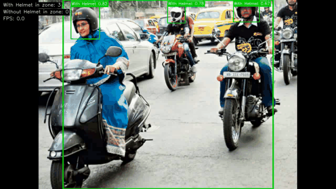
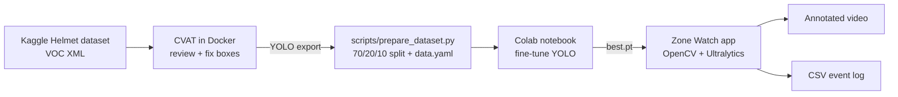

# Zone Watch 🦺

**Real-time helmet detection inside a user-drawn zone.** Draw a rectangle on a live webcam or video feed; a custom-trained YOLO model detects people *with* and *without* a helmet only inside that zone, counts them, and raises an alert when someone without a helmet enters.

<!-- TODO (Phase 4): replace with a real recording -->


---

## Highlights

- End-to-end CV pipeline: **annotation (CVAT) → data prep → training (Colab GPU) → real-time app → Docker**
- Custom fine-tuned **YOLO** detector (Ultralytics), 2 classes
- Interactive **ROI** drawn with the mouse, centre-in-zone filtering, live counts and FPS
- Visual + logged **alerts** (CSV event log), optional annotated video export
- Config-driven (no hard-coded paths/thresholds), type-hinted, documented code

## Architecture



<!-- TODO (Phase 4): add an app-level diagram (frame → detect → ROI filter → overlay/alert → log) -->

## Pipeline

| Phase | What | Where |
|------:|------|-------|
| 1 | Annotation review + extra labels in CVAT (local Docker) | [docs/](docs/) |
| 2 | Reproducible train/val/test split, `data.yaml` | `scripts/` |
| 3 | Fine-tuning on Google Colab (free GPU) | `notebooks/train_colab.ipynb` |
| 4 | ROI detection app | `src/zone_watch/` |
| 5 | Dockerised inference | `Dockerfile` |

## Results

<!-- TODO (Phase 3): fill from the Colab run -->

| Model | mAP@50 | mAP@50-95 | Precision | Recall | FPS (CPU) |
|-------|-------:|----------:|----------:|-------:|----------:|
| YOLO nano | – | – | – | – | – |

## Project structure

```
zone-watch/
├── configs/      # YAML config for the app (model path, thresholds, ...)
├── data/         # datasets (git-ignored)
├── docs/         # setup guides, images, diagrams
├── models/       # trained weights, e.g. best.pt (git-ignored)
├── notebooks/    # Colab training notebook
├── scripts/      # data download / prep utilities
└── src/zone_watch/  # the application package
```

## Getting started

<!-- TODO (Phase 4/5): exact commands -->

```bash
python -m venv .venv
.venv\Scripts\activate          # Windows  (Linux/Mac: source .venv/bin/activate)
pip install -r requirements.txt
```

## Dataset

[Helmet Detection](https://www.kaggle.com/datasets/andrewmvd/helmet-detection) (Kaggle, 764 images, 2 classes, Pascal VOC). Raw data is **not** committed; see the Phase 1 guide to download it.

## What I learned

<!-- TODO: fill in as the project progresses -->

## License

MIT (code). Dataset subject to its original licence on Kaggle.
