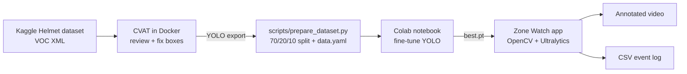
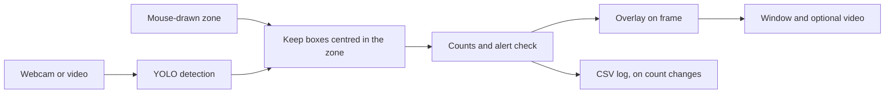

# Zone Watch 🦺

**Real-time helmet detection inside a user-drawn zone.** Draw a rectangle on a live webcam or video feed; a custom-trained YOLO model detects people *with* and *without* a helmet only inside that zone, counts them, and raises an alert when someone without a helmet enters.

<!-- TODO (Phase 4): replace with a real recording -->


---

## Highlights

- End-to-end CV pipeline: **annotation (CVAT) → data prep → training (Colab GPU) → real-time app → Docker**
- Custom fine-tuned **YOLO** detector (Ultralytics), 2 classes
- Interactive **ROI** drawn with the mouse, centre-in-zone filtering, live counts and FPS
- Visual + logged **alerts** (CSV event log), optional annotated video export
- Config-driven (no hard-coded paths/thresholds), type-hinted, documented code

## Architecture



Each frame in the app goes through the same steps:



## Pipeline

| Phase | What | Where |
|------:|------|-------|
| 1 | Annotation review + extra labels in CVAT (local Docker) | [docs/](docs/) |
| 2 | Reproducible train/val/test split, `data.yaml` | `scripts/` |
| 3 | Fine-tuning on Google Colab (free GPU) | `notebooks/train_colab.ipynb` |
| 4 | ROI detection app | `src/zone_watch/` |
| 5 | Dockerised inference | `Dockerfile`, [docs/docker.md](docs/docker.md) |

## Results

YOLO11n fine-tuned on 524 images, measured on the held-out test split (74 images, 152 boxes):

| Class | Precision | Recall | mAP@50 | mAP@50-95 |
|-------|----------:|-------:|-------:|----------:|
| All | 0.625 | 0.805 | 0.734 | 0.440 |
| With Helmet | 0.728 | 0.928 | 0.861 | 0.514 |
| Without Helmet | 0.521 | 0.681 | 0.607 | 0.365 |

The rarer *Without Helmet* class is the weak spot: about one in three such boxes is missed. The test split is small (48 *Without Helmet* boxes), so these numbers carry real uncertainty.

**Speed:** about 20 FPS on CPU (Ryzen 9 7845HX, 1280x720 video, including drawing and video saving).

## Project structure

```
zone-watch/
├── configs/      # YAML config for the app (model path, thresholds, ...)
├── data/         # datasets (git-ignored)
├── docs/         # setup guides, images, diagrams
├── models/       # trained weights, e.g. best.pt (git-ignored)
├── notebooks/    # Colab training notebook
├── scripts/      # data download / prep utilities
├── src/zone_watch/  # the application package
└── tests/        # tests for the zone, alert and logging logic
```

## Getting started

Trained weights are not in the repo: put your `best.pt` in `models/`.

```bash
python -m venv .venv
.venv\Scripts\activate          # Windows  (Linux/Mac: source .venv/bin/activate)
pip install -r requirements.txt
pip install -e .
```

Run on a webcam or a video file, then drag with the mouse to draw the zone (`r` resets it, `q` quits):

```bash
python -m zone_watch --source 0
python -m zone_watch --source path/to/video.mp4 --save-video outputs/annotated.mp4
```

Run without a window by giving the zone as `x1,y1,x2,y2`:

```bash
python -m zone_watch --source path/to/video.mp4 --roi 100,100,800,600 --no-display --save-video outputs/annotated.mp4
```

Defaults such as the model path and confidence threshold are in `configs/app.yaml`. Events go to `logs/events.csv`. To run the tests:

```bash
pip install -r requirements-dev.txt
pytest
```

### Docker

```bash
docker compose build
docker compose run --rm zone-watch --source videos/input.mp4 --roi 100,100,800,600 --no-display --save-video outputs/annotated.mp4
```

Video files work everywhere. Webcam access inside a container works on Linux only: see [docs/docker.md](docs/docker.md).

## Dataset

[Helmet Detection](https://www.kaggle.com/datasets/andrewmvd/helmet-detection) (Kaggle, 764 images, 2 classes, Pascal VOC). Raw data is **not** committed; see the Phase 1 guide to download it.

## What I learned

<!-- TODO: fill in as the project progresses -->

## License

MIT (code). Dataset subject to its original licence on Kaggle.
